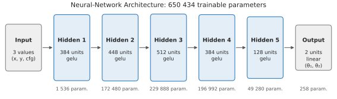
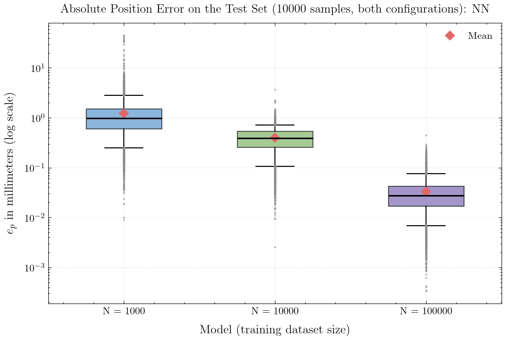
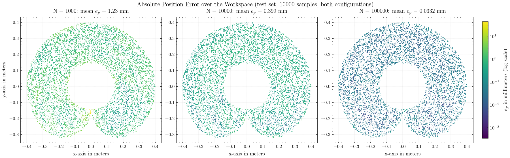
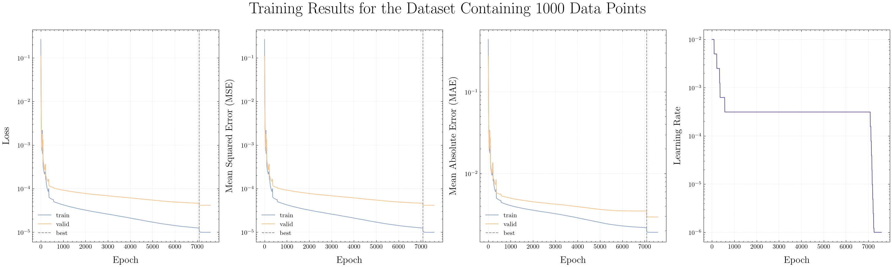
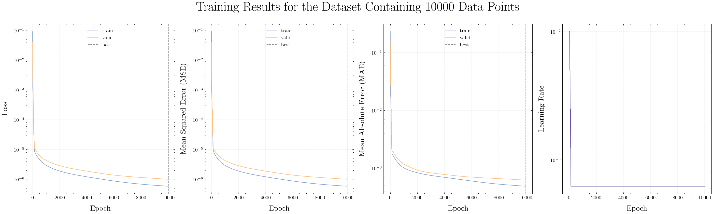
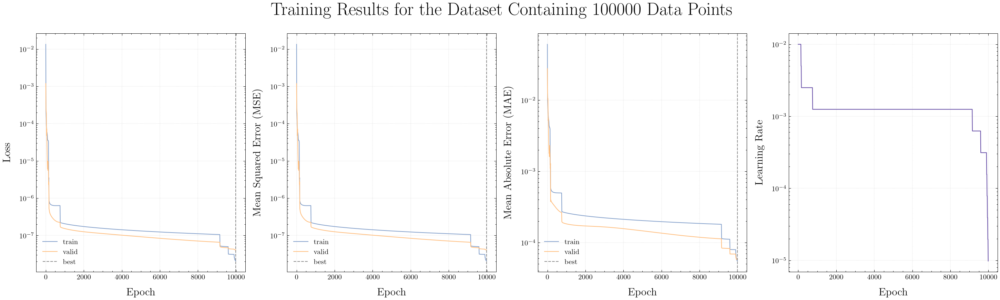

# FCNN Inverse Kinematics: 2-Link Planar Robot

A fully-connected neural network (FCNN) that learns the inverse kinematics of a 2-link planar robot (the first two axes of the Epson LS3-B401S SCARA). The input is the end-effector position and the solution configuration (x, y, cfg); the output is the pair of absolute joint positions (θ₁, θ₂). Trained on 100 000 generated samples, the network reaches a mean position error of 0.033 mm (max 0.45 mm) on a fixed test set of 10 000 samples.

## Architecture



- 5 hidden layers (384–448–512–384–128 units), GELU activation, linear output; 650 434 trainable parameters.
- Inputs and outputs min-max scaled to [-1, 1]; loss: mean squared error of the scaled joint positions.
- Adam with learning rate 1e-2 and ε = 1e-4 (for stable training at this learning rate), learning-rate halving on plateau (patience 20 epochs), early stopping (patience 500 epochs), at most 10 000 epochs, batch size 128.
- Architecture and learning rate selected by a 30-trial Bayesian search on N = 10 000 (KerasTuner); the same setup is used for all dataset sizes.

## Data

- End-effector positions are sampled uniformly in the Cartesian workspace; both IK solutions are computed analytically and wrapped into the joint limits (θ₁ ∈ [-40°, 220°], θ₂ ∈ [-140°, 140°]).
- Only solutions within the joint limits are kept. Datasets: N = 1 000, 10 000 and 100 000 samples (80/20 train/validation split).
- All models are evaluated on the same fixed test set of 10 000 samples (seed 1).

## Installation

Python 3.12:

```bash
pip install -r requirements.txt
```

Native Windows TensorFlow is CPU-only; use WSL2 or Linux for GPU training.

## Usage

The scripts are run from their own directory.

Data generation (`Data/Dataset/`):

```bash
cd Dataset_Generation
python generate.py 1000 train; python generate.py 10000 train; python generate.py 100000 train   # Config_N_{N}.zip
python generate.py 10000 test    # Test_N_10000.zip (generated once, shared by all models)
```

Hyperparameter optimization (`Training/Hyperparameters/`):

```bash
cd Training
python optimize.py
```

Training (set `CONST_NUM_OF_DATA` in `train.py`; output in `Data/Model/`):

```bash
cd Training
python train.py
```

Evaluation (`Data/Results/Results.csv`; figures via the `visu_*.py` scripts with `CONST_SAVE_FIGURE = True`):

```bash
cd Evaluation/Model
python evaluate.py
```

Prediction (from the project folder):

```python
import sys; sys.path.append('src')
import numpy as np
import FCNN_IK.Model, Parameters.Robot

path = 'Data/Model/Config_N_100000'
predictor = FCNN_IK.Model.FCNN_Predictor_Cls(f'{path}_Scaler_x.pkl', f'{path}_Scaler_y.pkl', f'{path}.keras',
                                             Parameters.Robot.EPSON_LS3_B401S_Str)
(info, theta) = predictor.Predict(np.array([0.25, 0.15, 0]))  # x [m], y [m], cfg (0 or 1)
# info  = {'within_limits': True, 'reachable': True}
# theta = [θ₁, θ₂] in radians
# Optional refinement: predictor.Predict(x, refine_iterations=20)
```

## Results

Fixed test set, 10 000 samples, both configurations. Position error ‖p − FK(θ̂)‖ in mm, joint error |θ − θ̂| in degrees.

| N | Mean (mm) | Median (mm) | p95 (mm) | Max (mm) | Mean joint error (°) | Within limits |
|---|---|---|---|---|---|---|
| 1 000 | 1.231 | 0.976 | 2.831 | 44.55 | 0.343 | 99.61 % |
| 10 000 | 0.399 | 0.387 | 0.714 | 3.673 | 0.082 | 99.98 % |
| 100 000 | 0.033 | 0.028 | 0.076 | 0.447 | 0.007 | 100 % |

Optional: refining the network output with 20 damped least-squares iterations on the analytical forward kinematics (NN + refinement) reduces the position error to ~5e-14 mm for all N, at 12 µs instead of 5–6 µs per sample.





Accuracy improves with the amount of generated data. Increasing N from 1 000 to 10 000 lowers the mean position error from 1.23 mm to 0.40 mm (3×) and the maximum from 44.6 mm to 3.7 mm; increasing N to 100 000 lowers the mean to 0.033 mm (12×) and the maximum to 0.45 mm. The mean joint error falls from 0.34° to 0.08° and 0.007°. The error remains higher near the θ₁ joint limits, but it decreases there with N as well.

<details>
<summary>Training history</summary>





</details>

## Limitations

- N = 10 000 and N = 100 000 stopped at the 10 000-epoch cap (best validation loss at epoch 10 000 and 9 988) while still improving; N = 1 000 stopped early at epoch 7 595.
- The largest remaining errors are near the θ₁ joint limits and at the workspace boundary (full stretch).
- The analytical IK is exact for this robot; the network is a reference for learning-based IK, not a replacement.

## Citation

```bibtex
@misc{RomanParak_FCNN_IK,
  author = {Roman Parak},
  title = {Fully-Connected Neural Network Inverse Kinematics (FCNN-IK) for a 2-Link Robotic Manipulator},
  year = {2026},
  publisher = {GitHub},
  journal = {GitHub repository},
  howpublished = {\url{https://github.com/rparak/FCNN_Inverse_Kinematics}}
}
```

## License

MIT, see [LICENSE](LICENSE).

## Contact

Roman.Parak@outlook.com
